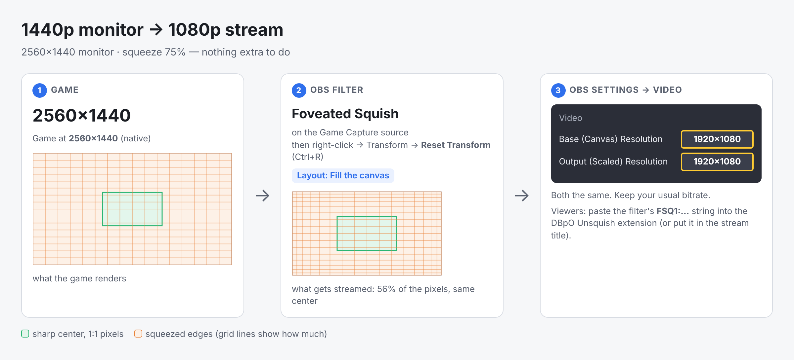

# Foveated Squish

Squeezes the **edges of the picture (X and Y)** while the center keeps exact 1:1 pixels, so a stream with a fixed bitrate (CBR) spends its bits where the viewer looks. Viewers unfold the picture with the **DBpO Unsquish** browser extension ([viewer/unsquish-extension](../../viewer/unsquish-extension/README.md)).

Why it works: at CBR the encoder spends the same number of bits per second regardless of the picture size. A 75% × 75% frame has 56% of the pixels, so each remaining pixel gets ~1.8× the bits. In the center nothing was removed, so all of that goes into quality. At the edges a squeezed pixel stands for several source pixels, which looks like a soft blur once unfolded. That is roughly what peripheral vision sees anyway. Unlike encoder ROI ("please spend more here"), this forces it.

Measured (x264 veryfast, 960×540 synthetic FPS pan, 60 fps; see [research/foveation](../../research/foveation/README.md)):

| CBR 250 kbps, clean | streamed | fovea | middle ring | outer |
|---|---|---|---|---|
| no squish | 960×540 | 35.0 dB | 35.7 dB | 36.1 dB |
| 75% × 75%, linear (default) | 720×404 | **37.6** | 36.8 | 34.4 |
| 75% × 75%, curve 1.5 | 720×404 | **37.7** | **38.0** | 33.9 |
| 65% × 65%, curve 0.5 | 624×352 | **38.9** | 38.1 | 34.0 |

## Setup

**Step-by-step with pictures for each resolution: [SETUP.md](SETUP.md).**

In short: the game renders at a higher resolution than your OBS canvas (e.g. 2560×1440 game, 1920×1080 canvas; on a 1080p monitor use NVIDIA DLDSR 1.78x). Pick your **Stream resolution** in the filter (1080p, 720p, 480p, 360p, or *Match my OBS canvas*). The filter squeezes the game to exactly that size, and the info line becomes a checklist that marks each OBS setting OK or CHANGE. Reset the source's transform (Ctrl+R) after adding the filter.



## Settings

| Setting | Meaning |
|---|---|
| Stream resolution | 1080p / 720p / 480p / 360p, *Match my OBS canvas*, or *Custom squeeze* (squeeze sliders; set the canvas to the size shown). The info line lists the OBS settings for that resolution with OK/CHANGE, the estimated saving, and the other resolutions for comparison. The center and curve sliders stop at what the chosen resolution allows. |
| Streamed width / height | Exact size only: squished size, % of the source. 75% is a good start; lower = sharper center, softer edges. (Fill derives it from the canvas.) |
| Full-quality center | The region kept at exact 1:1 pixels, 1–99% of the frame (width; separate height when unlinked). It can't exceed the total squeeze: at 75% the max is ~70%. |
| Focus position | Where the sharp center sits, 1–99% (crosshair = 50/50). |
| Curve | 0.1–10; the useful top depends on the squeeze (about 1.6 at 75%). How the squeeze ramps from the center edge to the frame edge. 1 = linear. Above 1: the ring right outside the center stays almost sharp and the far edges take the squeeze (best middle ring in tests). Below 1: squeeze starts right away, which allows stronger total squeeze. |
| Same settings for height | Links the vertical settings to the horizontal ones. |
| Max edge compression | 8×, 12.5× (default), 16×, 25×, 50×. How many source pixels the outermost streamed pixel may stand for. Hard curves (high values) put all the squeeze at the very edge, so they need a higher limit to squeeze much. Above ~16 the outer edge turns into a smear. |
| Area filter | Averages all source pixels a squeezed pixel covers. Prevents shimmer/aliasing at the edges; keep on. |
| View | *Squished* (what is streamed), *Unsquished preview* (what extension viewers see), *Squeezed zone* (red = squeezed harder). |

If you ask for more squeeze than the curve, center size and max edge compression allow, the filter limits it and says so. Raise Max edge compression, or lower the curve value or the center size, to go further.

While you drag sliders the panel doesn't rebuild (rebuilding made the sliders jump). Copy always copies the current config string; the text field and the Exact-size numbers show the state as of opening the filter window. For live feedback use **View → Squeezed zone** (green = full-quality center outline, red = squeeze strength).

## Config string

```
FSQ1:rx=0.75,ry=0.75,cx=0.15,cy=0.15,fx=0.5,fy=0.5,px=1,py=1,ar=1.7778
```

`r` = squished/source size, `c` = half-size of the sharp center, `f` = focus position, `p` = curve, `ar` = source aspect ratio (the extension shows the unfolded picture at this shape). The same mapping is implemented in the shader, in C (`src/squish-math.c`), in the extension (`squish.js`) and in Python (`research/foveation/squish_math.py`); the tests check all of them against the Python reference.

## Limits

- Viewers without the extension see a squeezed picture: center normal, edges compressed. It's watchable but odd, so tell them.
- The center is sharp for the configured focus point only. Per-viewer gaze would need a separate stream per viewer (see the tile notes in the research README).
- Chat overlays and webcams inside the squished source get squeezed too. Put them inside the sharp center, or accept that.
