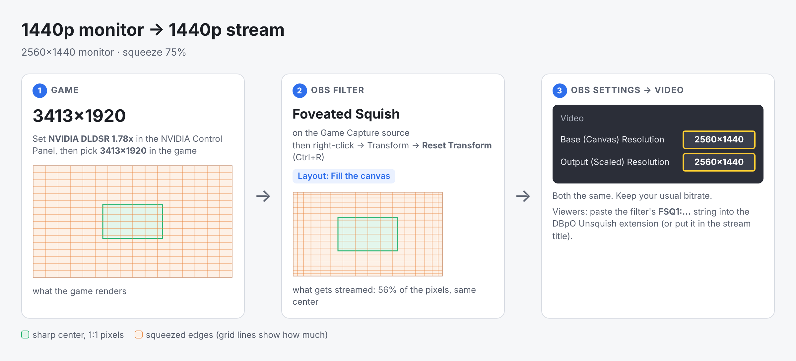
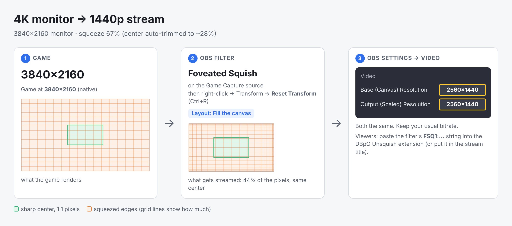
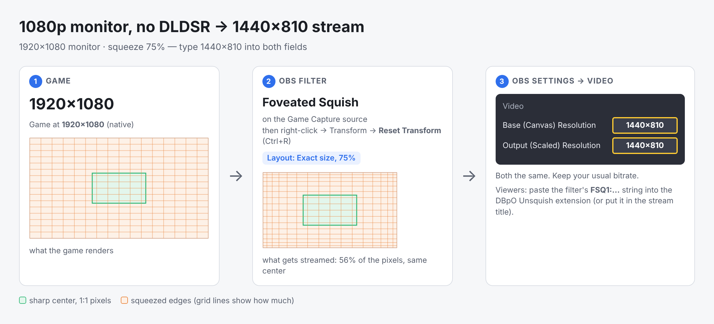

# Foveated Squish: setup by resolution

The one rule: **the game has to render at a higher resolution than your OBS canvas.** The filter squeezes the game down to exactly the canvas size, so the sharp center keeps every pixel and only the edges are compressed. The OBS canvas stays a normal size (1920×1080, 2560×1440).

If the game runs at the same resolution as the canvas, there is nothing to squeeze and the filter does nothing. Its info line then says **NOT SQUEEZING**.

## Find your row

| Your monitor | You stream at | Game resolution | How to get it | Squeeze | Guide |
|---|---|---|---|---|---|
| 2560×1440 | **1920×1080** | 2560×1440 | native, nothing extra | 75% ✅ best | [A](#a-1440p-monitor--1080p-stream) |
| 1920×1080 | **1920×1080** | 2560×1440 | NVIDIA DLDSR 1.78x | 75% ✅ best | [B](#b-1080p-monitor--1080p-stream-dldsr) |
| 2560×1440 | **2560×1440** | 3413×1920 | NVIDIA DLDSR 1.78x | 75% ✅ best | [C](#c-1440p-monitor--1440p-stream-dldsr) |
| 3840×2160 | **2560×1440** | 3840×2160 | native, nothing extra | 67% | [D](#d-4k-monitor--1440p-stream) |
| 1920×1080 | 1440×810 | 1920×1080 | native, no DLDSR needed | 75% | [E](#e-1080p-monitor-no-dldsr--1440810-stream) |

Not recommended:
- **4K monitor → 1080p stream** (50%): the sharp center has to shrink to about 5% of the frame to squeeze that hard. Run the game at 2560×1440 instead and use row A.
- **Streaming a 4K canvas:** the game would have to render above 4K. Stream 1440p (row D).
- **Black bars:** they cost the encoder about half of the gain, so the filter no longer offers them.

## Steps (same for every row)

1. **Game resolution.** Set the game to the "Game resolution" from your row. For DLDSR, see [Turning on DLDSR](#turning-on-dldsr) first. PlanetSide 2: use **Fullscreen** mode so the DLDSR resolution is offered.
2. **OBS Settings → Video.** Set **Base (Canvas) Resolution** and **Output (Scaled) Resolution** to the same value: "You stream at" from your row. These fields accept typed values (needed only for row E).
3. **Add the filter.** Right-click your **Game Capture** source → *Filters* → **+** under *Effect Filters* → **Foveated Squish**. **Layout: Fill the canvas** (default; row E: *Exact size*, 75%).
4. **Reset the transform.** Close the filter window, right-click the Game Capture source → *Transform* → **Reset Transform** (Ctrl+R). The source must sit at 100% scale. If it was scaled down to fit the canvas before, the squished picture would be scaled down again.
5. **Check the info line** at the top of the filter, for example: *Source 2560x1440 -> squeezed to fill your 1920x1080 canvas (75% x 75%)*. If it says NOT SQUEEZING, the game resolution is not above the canvas.
6. **Bitrate:** keep what you use now. Same bits, fewer pixels, so the center gets more.
7. **Viewers:** in the filter, open *Share with viewers* → **Copy config to clipboard**, then put that `FSQ1:…` string in your stream title, or send it via a messenger. Viewers install the [DBpO Unsquish extension](../../viewer/unsquish-extension/README.md) and paste it there.

Optional check: set the filter's **View** to *Unsquished preview* to see what extension viewers will see, then set it back to *Squished* before going live.

## Center size vs. how much is sacrificed

Two different knobs:

- **How much is thrown away in total** = streamed pixels ÷ game pixels. In *Fill the canvas* that's **canvas ÷ game resolution**, so it is set by your canvas, not by a slider. 2560×1440 game on a 1920×1080 canvas = 75% per side.
- **Full-quality center** (slider) = how much of the frame is kept untouched. The rest absorbs the whole squeeze.

The center can never be better than full quality (1:1 pixels). A smaller center doesn't make the center sharper; it only spreads the same total squeeze over more of the frame. To sacrifice the edges harder, stream fewer pixels: keep the game at 2560×1440 and lower the canvas.

| Game 2560×1440 → canvas | Streamed pixels | Full-quality center up to (12.5× / 50× edge compression) | Estimated saving for the same center quality |
|---|---|---|---|
| 1920×1080 | 56% | 70% / 72% | 25–38% |
| 1600×900 | 39% | 55% / 58% | 37–54% |
| 1280×720 | 25% | 40% / 44% | 49–69% |
| 960×540 | 14% | 25% / 30% | 57–78% |
| 768×432 | 9% | 16% / 21% | 61–84% |
| 640×360 | 6% | **10%** / 16% | ~60–85%, barely more than 768×432 |
| 512×288 | 4% | 4% / **10%** | ~60–85% |

The filter's info line shows this table for your actual game resolution, with "<- now" next to your current canvas.

- **A 10% full-quality center** needs about a 640×360 canvas (or 512×288 with *Max edge compression* at 50).
- **Diminishing returns below ~9% of the pixels:** the center is already close to perfect at your bitrate, so streaming even fewer pixels mostly just ruins the edges. In tests, 9% of the pixels saved up to 74%, 6% saved 74%, and 4% saved 80%.
- **About the estimate:** "same center quality at X% less bitrate" was measured with x264 on synthetic game footage at a starved bitrate (low = clean picture, high = grainy). With NVENC and real game footage the numbers will differ. Use it to compare settings, not as a promise. Measure on your own footage when you can.

Example: you want a 30% center at full quality and everything else heavily squeezed. Use a 1280×720 canvas, a full-quality center of 30%, and a low curve. Viewers with the extension see a 2560×1440-shaped picture whose center is exactly the game's pixels.

**Curve:** low values (0.1–0.5) squeeze everything outside the center evenly, so there's a hard step at the center's edge. 1 is a linear ramp. High values keep a ring around the center almost sharp and push the squeeze to the far edges. A high curve can only throw away a little in total, so at 75% the curve tops out around 1.5–1.7, and higher slider values have no further effect (the filter lowers the curve automatically). Set **View → Squeezed zone** while you adjust: the preview shows the full-quality center as a green outline and tints the edges red by how hard they are squeezed, live, without reopening the filter.

## A. 1440p monitor → 1080p stream

## B. 1080p monitor → 1080p stream (DLDSR)

## C. 1440p monitor → 1440p stream (DLDSR)

3413×1920 is DLDSR 1.78x on a 1440p monitor. The filter computes 2560/3413 = 75%.

## D. 4K monitor → 1440p stream

67% is a bit beyond what the default curve allows with a 30% sharp center, so the filter trims the center to about 28% automatically. The info line shows the exact value.

## E. 1080p monitor, no DLDSR → 1440×810 stream

No extra GPU load. The stream is 1440×810 instead of a standard size. Twitch and YouTube accept that, but viewers without the extension see a 1440×810 picture.

## Turning on DLDSR

DLDSR makes the game render above your monitor's resolution. The GPU does more work, but the RTX AI downscale keeps your own view sharp.

1. Right-click the desktop → *Show more options* → **NVIDIA Control Panel** (or right-click the NVIDIA tray icon).
2. **Manage 3D Settings → Global Settings → DSR - Factors:** tick **1.78x DL**. You can leave *DSR - Smoothness* at its default.
3. Apply. The new resolution now appears in games: 2560×1440 on a 1080p monitor, 3413×1920 on a 1440p monitor.
4. In the game choose that resolution in **Fullscreen** mode. In borderless/windowed mode the game uses the desktop resolution.

1.78x is exactly 4/3 per side, which is exactly the 75% squeeze that measured best.

## Troubleshooting

| What you see | Cause | Fix |
|---|---|---|
| Info line says NOT SQUEEZING | Game resolution ≤ canvas | Raise the game resolution (DLDSR) or lower the canvas |
| Picture is smaller than the canvas, black around it | Source is still scaled from before | Right-click the source → Transform → **Reset Transform** |
| Picture is bigger than the canvas / cut off | Canvas changed after adding the filter, or the transform was scaled up | Reset Transform; reopen the filter to recheck the info line |
| Info line says the curve/center was lowered | The center + curve can't absorb this much squeeze | Lower the curve, make the center smaller, or raise Max edge compression |
| Filter reports a size that isn't your game's (e.g. 2763×1554) | Filter is on a group/nested scene (its size is the box around everything inside), or another filter above it resizes | Put the filter on the Game Capture source itself, at the bottom of its filter list |
| Viewers see a squeezed picture | Extension missing, or config not pasted | Share the `FSQ1:…` string again; copy it after any settings change |
